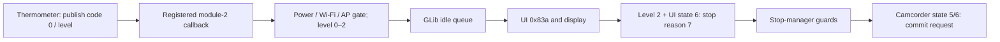

# Temperature callbacks, recording policy and adjustment provenance — RUN009

The app registers the thermometer callback and asynchronously publishes levels
0–2 to UI value `0x83a`. Level 2 can request a high-temperature recording stop;
the stop manager and camcorder wrapper each have additional guards. A separate
recording eligibility branch queries sensorapi and denies level 2. These are
conditional static paths, not proof that every high-temperature event stops a
recording, saves a file or shuts the camera down.

Factory adjustment descriptors and defaults are now recovered. Their defaults
are **mode 4, CIS 106/110, CPU 102/105 and ISP 106/110**. The active thermometer
reads a mapped preference area, not these original ELF bytes directly. The
factory defaults, prefman's zero-filled embedded defaults and device NVD values
must remain distinct.

## Sources and method

| Original ELF | SHA-256 |
|---|---|
| `/usr/apps/com.samsung.di-camera-app/bin/di-camera-app` | `55dcc78143724435a2e38b9e0d809960bd728668634bbcf7532ce137f882eb04` |
| `/usr/lib/libdi-sensor.so` | `75541051bc8e6090ec32d75e1b1b921a965b5a1cad26bf9a0683f7feb93bed07` |
| `/usr/lib/libfactory-mode.so` | `364075adfec81e43e416944541be0890649c24f20aebbe341add1eee510ab434` |
| `/usr/lib/libprefman.so` | `c44802d1983bd07eaf53f02761cf402143bce245b7e5d20499c62ce1164df18d` |

All addresses below are original ELF link VAs. The app's Ghidra addresses match
them; the three DSOs' Ghidra addresses add `0x10000`. PT_LOAD maps file offsets
independently. Saved TMode queries, original Capstone windows and source SHA
bindings accompany [selected C evidence](../evidence/thermal-policy-run009.json).
[Data evidence](../evidence/thermal-policy-data-run009.json) includes descriptor
bytes, separate default words, the default-pointer ABS32 relocation, physical
mapping and NVD backing records. No target code or device was executed/accessed.

## Callback registration and delivery

On its sequence-0 branch, `UI_Init_Sensor_Detection_Event` (`0x271f6c`) registers
callback ID 3 to `0x271920` and starts sensor polling. Wrapper
`UI_Di_Sensor_Set_Callback` (`0x1d0a38`) translates ID 3 into
`sensorapi::set_callback(2,0,fn)`. Sensor API `0x63bc` selects module 2;
`csensor_module::set_callback` (`0x3b2c`) stores the code/function pair in its
callback vector, with duplicate-pair handling. The module's `send_callback`
(`0x38f0`) calls matching entries while holding its callback mutex at `+0x28`.
The RUN008 thermometer binding establishes module 2 and publication with code 0.

App callback `0x271920` proceeds only when
`Ui_Check_Wifi_Or_Power_Off(2,6)` returns zero. This gate inspects power-off,
Wi-Fi and AP-setting state; its name alone is not treated as a complete policy.
The original unsigned comparison accepts precisely values **0, 1 and 2** and
queues `g_idle_add(0x271678,level)`. It does not directly run the UI handler on
the sensor thread. `UI_Test_Temperature` (`0x27210c`) separately queues the same
handler; it is a test entry, not the normal acquisition source.

Handler `0x271678` sets UI value `0x83a`, calls
`UI_Display_Manage(0x33,level,0,0,0)`, and, only when level is 2 and UI `0x27a`
equals 6, calls `UI_Manage_Movie_Stop(7)` followed by display operation
`(0xd,0x71,0,0,0)`. The string mapper at `0x2098b4` names stop reason 7
`eUS_REC_STOP_HIGH_TEMPERATURE`.

## Recording eligibility and stop boundaries

`UI_Check_Enable_Movie_rec` (`0xe4868`) has numerous preceding lens, storage,
network and state decisions. On the inspected path reaching its temperature
check, it calls `UI_Di_Sensor_Get_Temp_Level` (`0x1d1224`), which queries
`sensorapi::get_value(2,"temp_level")`. When the returned level equals 2, it
requests display operation `(0xc,0xba,5,0,0)` and returns zero. This query is
distinct from the callback-maintained UI `0x83a`; earlier return paths prevent
claiming the temperature test dominates every possible eligibility result.

`UI_Manage_Movie_Stop` (`0xe7284`) may return immediately for reason 7 if both
flag bytes at `0x49e7c8/0x49e7c9` are zero and either UI `0x27a` is not 6 or UI
`0x2bc` is less than 1. The callback's state test does not eliminate the latter
guard. On its ordinary reason-7 branch it clears the fader flag, computes a
standby/reset choice through `0xe2a7c`, and calls `0xe2c00(0,choice)`.

Helper `0xe2c00` calls `UI_Mm_Camcorder_Commit` (`0x1d5138`) when its first
argument is not 1; its cancel branch is separate. The commit wrapper calls
`mmf_camcorder_commit(handle)` only for returned camcorder states 5 or 6.
It checks and logs a nonzero return, but the selected wrapper does not return
that result to the UI manager. The helper's return 1 is not a checked recording
or storage success result. State transitions, asynchronous completion, video
file finalization and persistence remain separate evidence questions.



## Adjustment identity, two defaults and live backing

`dfms_get_adjdata` (`0xb8874`) uses the ID's two ARM argument words: lower
word is an offset, upper word `0x85600000` selects preference group 4. It calls
`pref_get_addr(4,&size)` and returns `mapped_base + 0x200 + offset`. It does not
simply dereference the upper argument as the requested setting's address.

The same `0x85600000` is also the **configured physical base** in prefman's
group-4 mapping record at `0x65a424`; these roles are related, not contradictory.
`pref_create_shm` (`0x54e0`) opens `/dev/mem`, rounds the configured `0xe00`
length to `0x1000` and requests a shared read/write mapping. `pref_get_shm`
(`0x5594`) supplies its cached/mapped process pointer. This is static mapping
configuration, not evidence that the mapping was available or initialized on
an observed boot.

Factory symbol `dfms_adjdata_sys_info` starts at `0xcc070`; its 96-byte records
bind names, a 64-bit ID and byte size. Factory default bytes start at
`dfms_adjdata_sys_default`, original `0xccf70`, and use the lower ID directly.

| Descriptor VA | Name | Lower ID | Factory default VA / value | Prefman embedded value |
|---|---|---:|---|---:|
| `0xccc10` | `TEMP_SENSOR_SELECT` | `0x91` | `0xcd001` / 4 | 0 |
| `0xccc70` | `TEMP_SENSOR_CIS_TH_WARNING` | `0x95` | `0xcd005` / 106 | 0 |
| `0xcccd0` | `TEMP_SENSOR_CIS_TH_CRITICAL` | `0x99` | `0xcd009` / 110 | 0 |
| `0xccd30` | `TEMP_SENSOR_CPU_TH_WARNING` | `0x9d` | `0xcd00d` / 102 | 0 |
| `0xccd90` | `TEMP_SENSOR_CPU_TH_CRITICAL` | `0xa1` | `0xcd011` / 105 | 0 |
| `0xccdf0` | `TEMP_SENSOR_ISP_TH_WARNING` | `0xa5` | `0xcd015` / 106 | 0 |
| `0xcce50` | `TEMP_SENSOR_ISP_TH_CRITICAL` | `0xa9` | `0xcd019` / 110 | 0 |

Each upper ID is `0x85600000`, and each descriptor size is four bytes. Mode 4
selects the larger CPU/ISP classified level in the RUN008 update body. A signed
warning/critical comparison is not by itself proof of a physical unit. TSU
driver units and CMOS conversion are investigated separately in RUN010.

Prefman's pointer at `0x65a310` has `R_ARM_ABS32` binding to `pref_sys_default`
(`0x361d4`) with zero addend. Its separate setting bytes at default base +
`0x200` + lower ID are all zero. Neither this zero table nor the factory table
proves the runtime contents of the mapped preference memory.

`nvd_load` (`0x56b0`) formats paths from group-4 record `0x6513f4` (`adj_sys`)
and shifts its selected sector offset left by 9:

| Selector | Configured backing path | Sector offset | Byte offset |
|---:|---|---:|---:|
| 0 | `/dev/mmcblk0p1` | 0 | 0 |
| 1 | `/dev/mmcblk0p3` | `0xc00` | `0x180000` |
| 2 | `/dev/mmcblk0p5` | 0 | 0 |

The companion word 8 is preserved without assigning a unit. `pref_load`
(`0x2bcc`) reads NVD data and checks expected size, magic `0x330033` and a CRC;
it has separate default/failure handling. `dfms_reset_adjdata_system`
(`0xbbddc`) calls `pref_load(4,1)` and then `pref_save(4)` on its nonnegative
branch. A function named reset is therefore not assumed to copy the recovered
factory defaults. `dfms_save_default_adjdata_all` (`0xbb590`) passes its own
factory-table defaults to `pref_save_default_to_file`; that is a separate path.
No statement here establishes which backing slot was used on a live boot or
whether its data equals either embedded default table.

## Reproduction and remaining work

```sh
PYTHONPATH=.work/python python tools/firmware/selected_elf_evidence.py \
  --root .work/run009 --output analysis/evidence/thermal-policy-run009.json \
  --relocation-term thermometer --relocation-term sensorapi \
  --relocation-term dfms --relocation-term pref_sys \
  --string-term TEMP_SENSOR_ --string-term HIGH_TEMPERATURE \
  --string-term thermometer --string-term /dev/mmcblk
PYTHONPATH=.work/python python tools/firmware/thermal_policy_data.py
```

One initial app export failed because a named program was nested under a
project folder and the command omitted recursive processing. Its failed receipt
and empty output are retained; the corrected generation validated successfully.
The runner now supports explicit `--recursive-process` for named programs.
Collection records that failed attempt and permits a checked per-generation
subset of the subsystem input manifest.

Remaining questions include live preference provenance/selection, polling
cadence, conversion and failure paths, completed video commit/error propagation,
and whether other thermal policies independently request power-off. No
temperature limit, recording policy, partition or firmware was changed.
